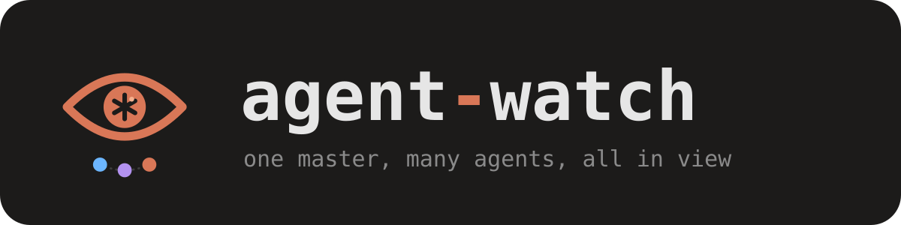
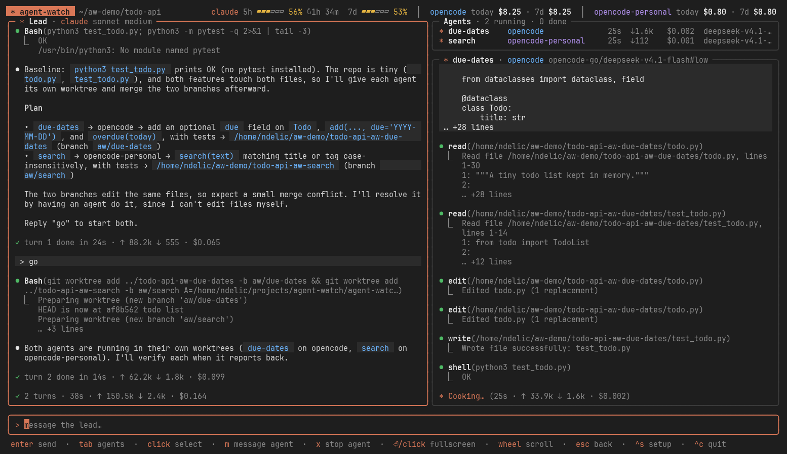

<p align="center"></p>

A terminal app where a **lead** agent puts coding **agents** to work, and you watch all of them live.

You chat with the lead. When you agree on work, it shows you a plan. After your go, it gives each agent its own git worktree and a detailed brief, verifies their work itself (diffs, your tests, its own probes, cheat checks) and sends feedback until it's right. It never edits code itself; it has no edit tools.

Claude Code and opencode can both lead or work, on any account and model, so Claude can lead opencode agents on cheap or free models, or the other way round.

<p align="center"></p>

## Quick start

**1. Have at least one agent CLI installed and logged in:** [Claude Code](https://claude.com/claude-code) (`claude`) and/or [opencode](https://opencode.ai) (`opencode`), plus `git`.

**2. Install** a [release](https://github.com/n-delic/agent-watch/releases) for Linux or macOS:

```bash
tar -xzf agent-watch_*.tar.gz
mkdir -p ~/.local/bin
mv agent-watch_*/agent-watch ~/.local/bin/
ln -s ~/.local/bin/agent-watch ~/.local/bin/aw     # the short name
```

or build it with [Go](https://go.dev/dl/) 1.24+:

```bash
git clone https://github.com/n-delic/agent-watch && cd agent-watch
go build -o agent-watch .
ln -s "$PWD/agent-watch" ~/.local/bin/agent-watch
ln -s "$PWD/agent-watch" ~/.local/bin/aw
```

(`~/.local/bin` must be on your `PATH`.)

**3. Run it in the project you want to work on:**

```bash
cd ~/code/my-project
aw
```

**4. Pick your agents.** The first launch opens the setup: choose the lead (cli, account, model, effort) and which agents it may put to work, then `enter`. Change it any time with `ctrl+s`.

**5. Talk to the lead** like you would to Claude Code:

> add rate limiting to the API client, use two agents

It reads the code, proposes a plan (which agent does what, in which worktree) and waits. Say **go**, then watch the agents work on the right. When they're done and verified, it asks before committing or merging anything.

**6. Come back later:** `aw -c` continues the latest run in a directory, `aw -r` lets you pick an older one. The lead and its agents pick up their conversations where they left off.

What you see:

- Transcripts in Claude Code style (`⏺` messages and tool calls, `⎿` output), with agents' markdown rendered: headings, lists, tables, code.
- A live spinner per agent with elapsed time, tokens (↑ in ↓ out) and cost; every turn ends with how long it took.
- A header with each Claude account's 5-hour and 7-day usage (from its own rate limit reports) and each opencode account's spend today and over 7 days (`opencode stats`; opencode has no limits API).

## Agents

An agent is a CLI, an account and a model. A fresh setup has one per installed CLI on its default account and model; add as many as you like in the setup (`ctrl+s`, then **+ add an agent**). Each has:

| Field | |
|---|---|
| name | what you and the lead call it, e.g. `work` |
| cli | `claude` or `opencode` |
| account | empty for the CLI's default login. Another opencode account: the path of its database (e.g. `~/.local/share/opencode/work.db`, run with `--standalone`). Another Claude account: its config dir (e.g. `~/.claude-work`, as `CLAUDE_CONFIG_DIR`). |
| model, effort | empty for the CLI's default. Type on a model row to search a list: opencode's own models for that account (with prices and effort levels; `free` finds the free ones), or Claude's. Effort then offers only that model's levels. |
| lead may use it | whether the lead can put it to work |

The lead has its own cli, account, model and effort, separate from the agents: changing an agent never changes the lead. The setup is saved to `~/.config/agent-watch/config.json`.

## Keys

| Key | |
|---|---|
| `enter` | send to the lead (or to the agent you're messaging) |
| `tab` | switch between input and agent list |
| `↑↓` | select an agent (in the list) |
| `enter` (list) | selected agent fullscreen |
| `m` (list) | message the selected agent directly; the lead is told |
| `x` (list) | stop the selected agent |
| `pgup` / `pgdn` | scroll the lead (or the agent when the list is focused) |
| `esc` | back |
| `ctrl+s` | setup |
| `ctrl+c` | quit (asks again if agents are running, then stops them) |
| click | an agent selects it, again opens it fullscreen; the fullscreen title closes it; a pane or the input focuses it |
| wheel | scrolls the pane under the pointer |

Mouse capture means selecting text needs `shift` + drag in most terminals.

## How it works

- The lead gets `lead.md` as its instructions and drives agents with `aw spawn|send|stop`. Those commands hand a request file to the running app, which checks it against your setup and starts the agent.
- When an agent finishes a turn, the app wakes the lead with the agent's final reply.
- Each turn has a 45-minute timeout. A stopped or timed-out turn is also interrupted on opencode's shared service, which would otherwise keep running it.
- Every run is saved in `~/.local/state/agent-watch/<run>/`: its state (sessions, transcripts, totals) and every agent's raw output.

## Update

Download the new release, or `git pull && go build -o agent-watch .`. Releases are built by GitHub Actions when a version tag is pushed: `git tag v0.2.0 && git push origin v0.2.0`.

## Limits

- Linux and macOS only.
- Agents run with full permissions (`--auto` / `bypassPermissions`), which is why the lead gives each its own worktree.
- Claude's token counts arrive at the end of each of its turns; opencode's update after every step.
- Not yet supported: Codex, local model servers.

## License

[MIT](LICENSE)
